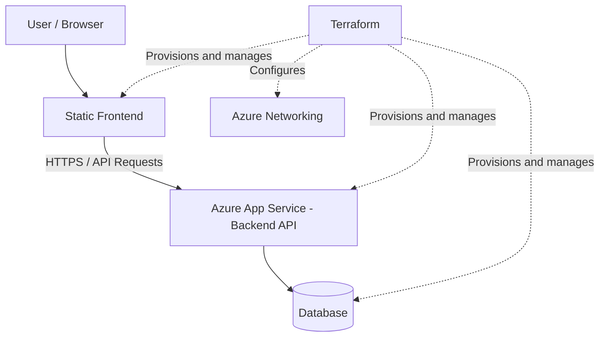

# Terraform Infrastructure for a Two-Tier Azure Application

Provision cloud infrastructure on Microsoft Azure using Terraform to host a web application with a static frontend, backend API, and database.

The project demonstrates Infrastructure as Code (IaC), cloud resource provisioning, and the separation of application components into independently managed layers.

## Architecture

The application consists of a static frontend, a backend hosted on Azure App Service, and a database layer for persistent data storage.



### Application Layers

| Layer | Component | Responsibility |
|---|---|---|
| Presentation | Static frontend | Serves the user interface through a browser |
| Application | Azure App Service | Hosts the backend API and processes application requests |
| Data | Database | Stores and retrieves application data |
| Infrastructure | Terraform | Provisions and manages cloud infrastructure |
| Networking | Azure network resources | Provides network connectivity and access control where configured |

## Objectives

- Automate Azure infrastructure provisioning using Terraform.
- Separate the frontend, backend, and database into distinct application components.
- Practise Infrastructure as Code and reusable infrastructure configuration.
- Understand communication between application layers.
- Apply cloud networking and security best practices.
- Establish a foundation for CI/CD automation and future improvements.

## Technology Stack

- **Cloud Platform:** Microsoft Azure
- **Infrastructure as Code:** Terraform
- **Configuration Language:** HashiCorp Configuration Language (HCL)
- **Frontend:** Static web application
- **Backend:** Azure App Service
- **Database:** Azure database service
- **Scripting:** Shell
- **Version Control:** Git and GitHub

## Repository Structure

```text
terraform-infra-2-tier-azure-app/
├── frontend/             # Frontend application files
├── network/              # Network-related configuration
├── main.tf               # Main infrastructure resources
├── network.tf            # Network infrastructure configuration
├── provider.tf           # Terraform provider configuration
├── variable.tf           # Input variables
├── output.tf             # Terraform outputs
├── cloud-init.sh         # VM initialization script, where applicable
├── .terraform.lock.hcl   # Terraform provider dependency lock file
├── .gitignore            # Files excluded from version control
└── README.md             # Project documentation
```

*Note: The repository structure and responsibilities may evolve as the project develops.*

## Prerequisites

Before deploying the infrastructure, ensure you have:

- An active Microsoft Azure subscription.
- An Azure account with permission to create the required resources.
- [Terraform](https://developer.hashicorp.com/terraform/install) installed.
- [Azure CLI](https://learn.microsoft.com/en-us/cli/azure/install-azure-cli) installed.
- [Git](https://git-scm.com/downloads) installed.

## Getting Started

### 1. Clone the repository

```bash
git clone https://github.com/Yashini13/terraform-infra-2-tier-azure-app.git
cd terraform-infra-2-tier-azure-app
```

### 2. Sign in to Azure

```bash
az login
```

If you have access to multiple subscriptions, select the intended subscription:

```bash
az account list --output table
az account set --subscription "<YOUR_SUBSCRIPTION_ID>"
```

Verify the active subscription:

```bash
az account show --output table
```

### 3. Initialize Terraform

Initialize the working directory and download the required provider plugins:

```bash
terraform init
```

### 4. Validate the configuration

Check the Terraform configuration for syntax and consistency issues:

```bash
terraform fmt -check
terraform validate
```

### 5. Review the execution plan

```bash
terraform plan
```

Review the proposed infrastructure changes before proceeding.

### 6. Deploy the infrastructure

After verifying the configuration, resource names, region, permissions, and expected costs, apply the Terraform configuration:

```bash
terraform apply
```

Review the plan and confirm the operation when prompted.

**Important:** The exact deployment commands and required variable values depend on the Terraform configuration. Complete any required variable files or command-line arguments before applying.

### 7. Inspect the outputs

```bash
terraform output
```

Use the resulting resource information to identify the application endpoints and other outputs exposed by the configuration.

## Security Considerations

Security is an important part of deploying a cloud application.

Recommended practices include:

- Use HTTPS for frontend-to-backend communication.
- Restrict database access to the backend wherever supported.
- Avoid exposing database credentials in source code or Git history.
- Store secrets in Azure Key Vault or another appropriate secret-management service.
- Follow the principle of least privilege when assigning Azure roles.
- Use private networking for database connectivity when supported by the architecture.
- Review network access rules and application configuration before deployment.
- Never commit passwords, access tokens, service principal secrets, or other sensitive information.

These are recommended practices; their implementation depends on the current infrastructure configuration.

## Cost Management

Azure resources can incur charges while deployed, even when the application receives little or no traffic.

Before deployment:

- Review the pricing of the selected App Service plan and database tier.
- Choose resource sizes appropriate for development and testing.
- Monitor spending through Azure Cost Management.
- Remove unused resources when the project is no longer needed.

To remove Terraform-managed infrastructure after testing:

```bash
terraform destroy
```

Review the proposed deletions carefully before confirming. This command can permanently remove resources and their data.

## Future Improvements

Potential enhancements for the project include:

- [ ] Configure remote Terraform state with Azure Storage.
- [ ] Separate development, testing, and production environments.
- [ ] Introduce reusable Terraform modules.
- [ ] Configure a CI/CD pipeline using GitHub Actions.
- [ ] Integrate Azure Key Vault for secrets management.
- [ ] Add managed identity for secure service-to-service authentication.
- [ ] Configure application monitoring and centralized logging.
- [ ] Improve database network isolation and access controls.
- [ ] Add automated infrastructure validation and security scanning.
- [ ] Document deployment verification and troubleshooting procedures.

## Learning Outcomes

This project provides an opportunity to develop practical skills in:

- Azure infrastructure provisioning.
- Terraform configuration and state management.
- Cloud application architecture.
- Networking and service connectivity.
- Identity and access management.
- Infrastructure automation.
- Cloud security and cost awareness.

## Contributing

Contributions, suggestions, and improvements are welcome.

1. Fork the repository.
2. Create a branch for your changes.
3. Make and validate your changes.
4. Submit a pull request describing the improvement.

Please avoid committing secrets or sensitive configuration files.

## Author

**Yashini Pardeshi**

- GitHub: [@Yashini13](https://github.com/Yashini13)
- Project Repository: [terraform-infra-2-tier-azure-app](https://github.com/Yashini13/terraform-infra-2-tier-azure-app)

---

*This project is intended for learning and demonstrating Azure cloud infrastructure automation using Terraform.*
